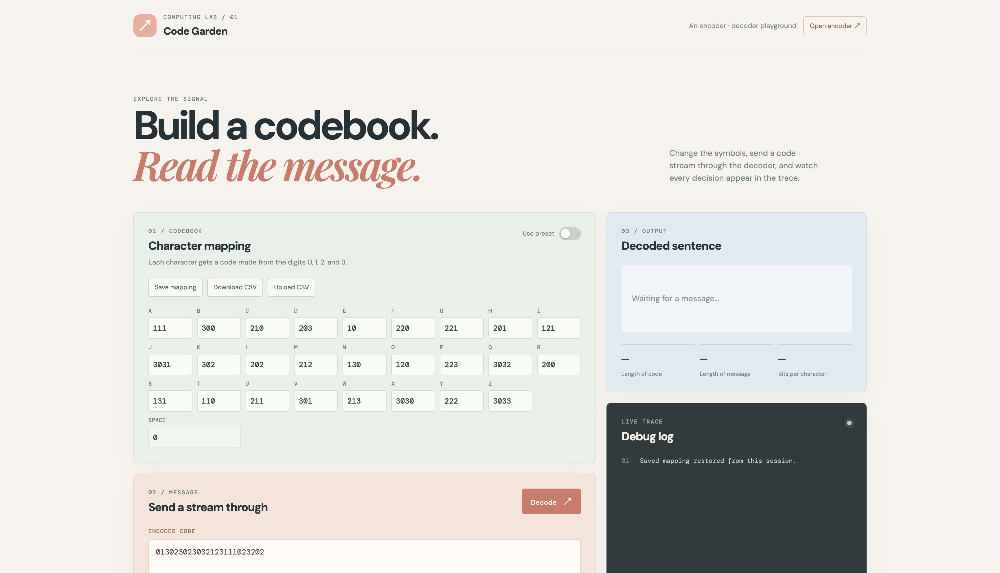

# Code Garden



Welcome to **Code Garden**, a hands-on encoder and decoder playground for exploring how character mappings become messages. Build a codebook, send a signal through the decoder, inspect every decision in the debug trace, and experiment with your own encoding ideas.

## What You Can Do

- Decode a stream of quaternary digits using a character mapping for `A-Z` and space.
- Edit every character code directly in the codebook.
- Toggle between the preset uniquely decodable dictionary and your custom mapping.
- Save a custom mapping for the current browser session.
- Upload or download mappings as CSV files.
- Save encoded messages in browser storage and review their plaintext-to-code mapping.
- Open a dedicated encoder in a new tab.
- Type a message and encode it instantly using the active dictionary.
- Download a PDF containing both the original message and encoded signal.
- Read the live Python debug trace as the encoder and decoder work.

## Getting Started

### Requirements

- Python 3.10 or newer
- Node.js and npm

### 1. Install frontend dependencies

From the project directory, run:

```bash
npm install
```

### 2. Start the Python backend

Open a terminal and run:

```bash
python main.py
```

The Python API is configured to run at this exact address:

```text
http://localhost:8500
```

### 3. Start the React frontend

Open a second terminal in the project directory and run:

```bash
npm run dev
```

Vite normally opens the frontend at:

```text
http://localhost:5173
```

If port `5173` is already in use, Vite will print a different available port in the terminal. Keep both terminals running while using the app. The frontend proxies its `/api` requests to the Python server on port `8500`.

## Decoder Walkthrough

1. Look at the **Character mapping** panel.
2. Leave **Use preset** enabled to experiment with `code2.csv`.
3. Turn the toggle off to edit a custom dictionary.
4. Enter a code for each character using only `0`, `1`, `2`, and `3`.
5. Enter an encoded stream in the **Encoded code** field.
6. Press **Decode**.
7. Read the decoded sentence, message statistics, and live debug trace.

The output reports:

- **Length of code**: the number of encoded digits, excluding grouping whitespace.
- **Length of message**: the number of decoded characters.
- **Bits per character**: the app displays the encoded digit count divided by decoded message length. Because these are quaternary codes, this is more precisely an average encoded digits-per-character value, not binary bits.

## Saving Custom Mappings

Press **Save mapping** after editing your custom codes. The mapping is saved in `sessionStorage` and restored when you reload or return to the page in the same browser tab/session. Use **Download CSV** if you want a durable file you can keep or share.

Use the CSV controls to move mappings between the app and your computer:

- **Download CSV** creates `character-mapping.csv`.
- **Upload CSV** loads a mapping with the columns `Character,Code`.

Example:

```csv
Character,Code
A,000
B,001
C,002
 ,123
```

## Saving Encoded Messages

After submitting a message, press **Save encoded message**. The app stores the result in `localStorage` and displays the saved records in the message panel, including:

- The original plaintext message
- Its encoded signal
- The time it was saved

These saved messages remain available when you reload the app in the same browser profile.

## The Encoder Tab

Press **Open encoder ↗** to open the encoder in a new browser tab. The active dictionary is passed to the new tab automatically.

In the encoder tab:

1. Type or paste a message.
2. Watch the encoded signal update immediately.
3. Press **Download PDF**.

The downloaded `encoded-message.pdf` contains the original message, encoded message, character count, and code length.

## Project Structure

```text
encoder_decoder_project/
├── main.py              Python localhost API and encoding logic
├── index.html           Decoder page
├── encoder.html         Dedicated encoder page
├── src/main.jsx         Decoder React interface
├── src/encoder.jsx      Encoder React interface and PDF export
├── src/styles.css       Decoder styling
├── src/encoder.css      Encoder styling
├── code.csv             Custom variable-length example mapping
├── code2.csv            Preset fixed-length mapping
├── code_huffman.csv     Additional mapping example
└── frontpage.png        Application preview
```

## Build for Production

To verify and build both browser pages:

```bash
npm run build
```

Vite outputs both `dist/index.html` and `dist/encoder.html`.

## Have Fun Experimenting

Try short messages first, then deliberately create ambiguous or incomplete mappings. Watch the debug trace closely: it shows the buffer growing, codes being recognized, unknown symbols being ignored, and unfinished signals becoming `?`. That trace is where the codebook becomes understandable.
